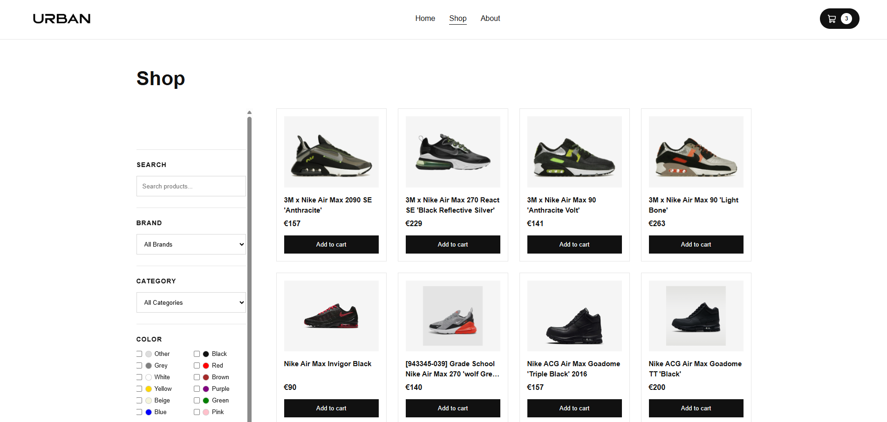
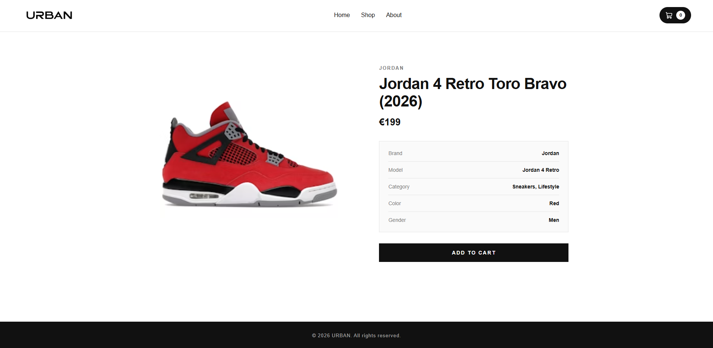

# URBAN — Sneaker E-Commerce Store

A responsive sneaker e-commerce frontend built with **React**, **Redux Toolkit**, and **Vite**. URBAN is a fictional streetwear brand developed as a portfolio project to explore product discovery, reusable components, global state management, and a simulated checkout experience.

**[View Live Demo](https://urban-sneaker-store.vercel.app/)** · **[GitHub Repository](https://github.com/dhmgiannakas-dev/urban-sneaker-store)**

## Features

- Sneaker product listings fetched from the SoleScout public search API
- Search products by name
- Filter by brand, category, color, and gender
- Select multiple colors and combine filters
- Sort products by price and reset all filters
- Dynamic product detail pages using React Router
- Add products to a shopping cart with Redux Toolkit
- Increase or decrease quantities, remove items, and clear the cart
- Persist cart items in `localStorage`
- Simulated checkout with an empty-cart route guard and order confirmation page
- Responsive layouts, loading and error states, and a custom 404 page

## Tech Stack

| Area | Technology |
| --- | --- |
| Frontend | React, JavaScript, Vite |
| Routing | React Router |
| Global state | Redux Toolkit, React Redux |
| Styling | CSS, CSS Grid, Flexbox, media queries |
| Icons | Lucide React |
| Product data | SoleScout public search API |
| Backend integration | Vercel Serverless Functions |
| Deployment | Vercel |

## Project Structure

```text
api/
  products.js                # Serverless API endpoint
src/
  components/                # Reusable UI components
  data/                      # Static data and helpers
  hooks/                     # Product loading and filtering hooks
  pages/                     # Route-level pages
  services/                  # Product fetching logic
  store/
    slices/                  # Redux cart slice
    store.js                 # Redux store configuration
  utils/                     # Product normalization and selection
  App.jsx                    # Routes and page composition
```

## Getting Started

### Prerequisites

- Node.js and npm (use a version supported by the project's Vite release)
- A Vercel account and the Vercel CLI, which can be run with `npx`

### Installation

1. Clone the repository:

   ```bash
   git clone https://github.com/dhmgiannakas-dev/urban-sneaker-store.git
   ```

2. Enter the project directory and install dependencies:

   ```bash
   cd urban-sneaker-store
   npm install
   ```

3. Log in to Vercel and link the project:

   ```bash
   npx vercel login
   npx vercel link
   ```

4. Start the application with the serverless API available:

   ```bash
   npx vercel dev
   ```

5. Open the local address shown in your terminal.

> **Important:** `npm run dev` starts the Vite frontend only. The frontend requests `/api/products`, which is served by the Vercel Serverless Function. Use `npx vercel dev` to run the complete application locally.

**No SoleScout API key is currently required** by the implemented public search endpoint. You do not need to create a `KICKS_API_KEY` environment variable.

### Other Commands

```bash
npm run build    # Create a production build
npm run preview  # Preview the Vite build locally
npm run lint     # Run ESLint
```

## Product API

Product data is retrieved from the [SoleScout](https://solescout.ai/) public search API via the Vercel Serverless Function at `/api/products`.

The function searches several sneaker-related terms, combines the results, removes duplicate products, excludes entries missing required product data, and returns a simplified response to the frontend. Frontend utilities then normalize product fields and prepare the collection for display.

The serverless endpoint sets cache headers to reduce repeated upstream requests. Product information, images, and availability depend on the external data source and may change.

**Pricing note:** SoleScout provides price values in **USD**. Currency formatting/conversion in the current storefront is an outstanding improvement; displayed euro symbols should not be interpreted as a verified USD-to-EUR conversion. The storefront does not provide live checkout pricing.

## State Management & Architecture

- **Redux Toolkit** manages cart items and quantity updates across pages.
- **localStorage** restores cart contents between visits.
- **Custom hooks** organize product fetching and Shop filtering.
- **Service and utility modules** separate API access, normalization, and product selection from UI components.
- **Reusable components** handle product cards, navigation, and filter controls.
- **React Router** manages the Home, Shop, Product Details, Cart, Checkout, Success, About, and 404 pages.

## Screenshots

### Home


### Shop



### Product Details



### Cart


### Checkout


## What I Learned

Building URBAN helped me practice:

- Designing React applications with reusable components and separation of concerns
- Choosing between local component state and global Redux state
- Creating custom hooks for shared application logic
- Working with React Router and dynamic route parameters
- Fetching, validating, filtering, and normalizing external API responses
- Using array methods such as `map`, `filter`, `find`, `reduce`, `some`, and `flatMap`
- Building controlled inputs, multi-select filters, and sorting controls
- Persisting cart state in `localStorage`
- Building responsive layouts with CSS Grid, Flexbox, and media queries
- Integrating serverless functions with a Vite frontend on Vercel
- Handling loading, errors, and basic accessibility concerns

## Project Scope

URBAN is a **portfolio/demo project**, not a production online store. Checkout and order confirmation are simulated; **no real payments are processed and no real orders are placed**.

Product listings and imagery originate from an external data provider. Before using the project commercially, the data provider's terms, attribution requirements, and image usage rights would need to be reviewed.