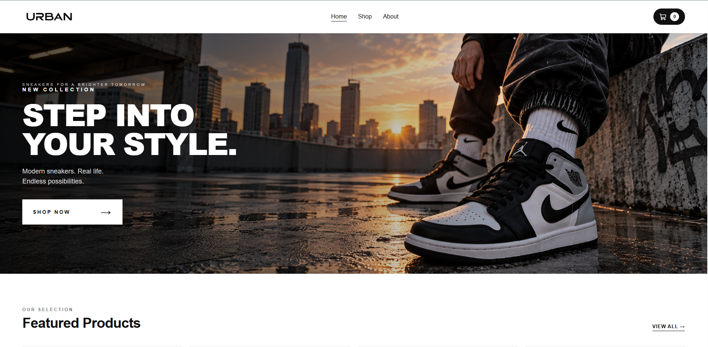
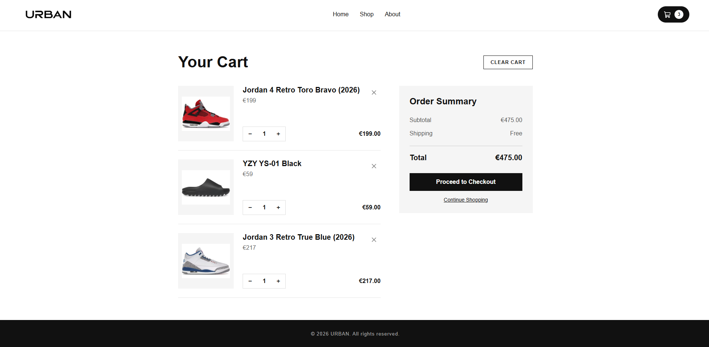
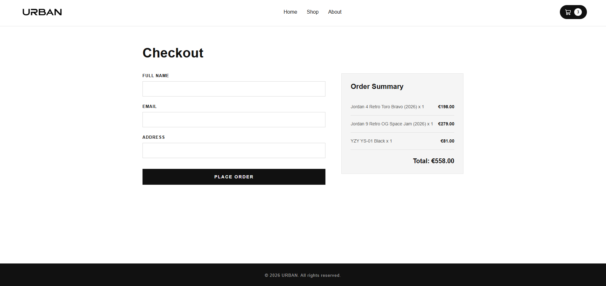

# URBAN — Sneaker E-Commerce Store

URBAN is a modern sneaker and streetwear e-commerce frontend built with React.

**[View Live Demo](https://urban-sneaker-store.vercel.app/)**

The project focuses on creating a clean and responsive shopping experience, featuring real sneaker product data, dynamic filtering, product pages, cart functionality, and a complete checkout flow.

## Features

- Sneaker products fetched from an external API
- Product search
- Filter by brand, category, color, and gender
- Multi-select color filtering
- Price sorting
- Reset filters
- Dynamic product detail pages
- Shopping cart
- Increase and decrease product quantities
- Remove products from cart
- Cart persistence with localStorage
- Checkout flow
- Checkout route protection for empty carts
- Order confirmation page
- Responsive design
- Loading and error states
- Custom 404 page

## Tech Stack

- React
- JavaScript
- React Router
- Vite
- CSS
- Lucide React
- KicksDB API

## What I Learned

While building URBAN, I practiced and improved my understanding of:

- React component architecture and reusable components
- Props and lifting state
- React state management with `useState`
- Side effects with `useEffect`
- Client-side routing with React Router
- Dynamic routes and URL parameters
- Fetching and normalizing API data
- Loading and error handling
- Array methods such as `map`, `filter`, `find`, `reduce`, `some`, and `flatMap`
- Building dynamic filters from API data
- Controlled form inputs and checkboxes
- Persisting application state with localStorage
- Responsive layouts with CSS Grid, Flexbox, and media queries
- Environment variables and API key security
- Serverless Functions with Vercel
- Basic accessibility practices

## Running Locally

Clone the repository:

```bash
git clone https://github.com/dhmgiannakas-dev/urban-sneaker-store.git
```

Navigate to the project directory:

```bash
cd urban-sneaker-store
```

Install dependencies:

```bash
npm install
```

Create a `.env` file in the project root and add your KicksDB API key:

```env
KICKS_API_KEY=your_api_key
```

Log in to Vercel and link the project:

```bash
npx vercel login
npx vercel link
```

Start the development server:

```bash
npx vercel dev
```

Open the local URL displayed in the terminal (usually `http://localhost:3000`).

**Note:** This project uses Vercel Serverless Functions to fetch product data. Running `npm run dev` starts only the Vite frontend and does not execute the API functions. Use `npx vercel dev` for full local functionality.

## API

Product data is provided by the KicksDB API.

API requests are handled through a Vercel Serverless Function (`/api/products`) instead of directly from the frontend.

The API key is stored securely in the `KICKS_API_KEY` environment variable and is never exposed to the client.

The `.env` file is excluded from version control.

For production deployment, the API key must be configured in the Vercel project's Environment Variables.

## Screenshots

### Home


### Shop


### Product Details


### Cart


### Checkout



## About the Project

URBAN is a fictional brand created as a portfolio project for practicing modern frontend development and building a complete e-commerce user experience.

This project does not process real payments or orders.